# Osu! for iPod touch

An osu!lazer-inspired rhythm game port for the **jailbroken iPod touch (2nd generation), running iOS 4.2.1**. Built for ARMv6 and its PowerVR MBX Lite GPU, with touch controls and a landscape **480 × 320** interface.

**Current build: v0.122**, installed on the development iPod. Based on the supplied **osu!lazer 2026.1005.0** source snapshot.

The port implements a substantial set of lazer features using a custom legacy runtime and platform adapter. It does not run the full desktop client unchanged, and does not claim complete gameplay, rendering or online-service parity.

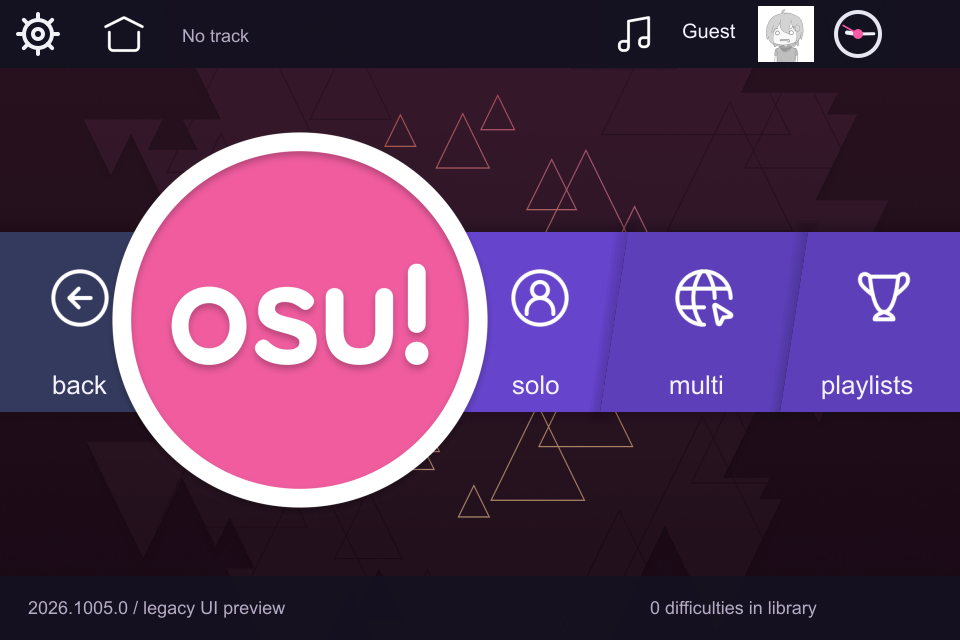

## Features

### Menus and interface

- “Welcome to osu!” intro sequence and startup music, with a non-skippable intro and prepared main-menu transition.
- Animated osu! logo, music-reactive visualizer ring, rising triangles, side effects and fireworks.
- Horizontal Play/Edit/Browse menus, source-derived icons, expanding/retracting logo and idle transitions.
- Settings sidebar, analog/digital toolbar clock, Guest profile icon and shared navigation controls.
- Notification bell, unread badge, progress cards, history, toasts and local error/retry actions. Notifications render above the song list, logo and other overlays.
- Optional wallpaper packs, startup randomisation and menu background transitions; triangle background remains available.
- Edge gestures for master/music/effects volume and brightness, with separate volume rings.

### Song library and beatmap browser

- Import `.osz` archives and discover loose `.osu` files.
- Incremental library display, early archive names, shuffled import order and priority loading for a selected pending song.
- Persistent metadata index: reuse unpacked maps on restart and scan for changed content rather than unpacking everything again.
- Group difficulties from the same song into a scrolling list, with search, sorting, random selection and retained song selection across ruleset tabs.
- Cover art and song backgrounds, screen-sized image preparation and an option to downsize further.
- Local star ratings for **osu!, taiko, catch and mania**, including converted maps and supported mod adjustments. Ratings calculate on a low-priority worker, prioritise the selected map, pause during gameplay and persist across restarts.
- Two-decimal star badges with lazer's difficulty colour spectrum, centred across the description card's bottom edge.
- Online Browse powered by [Hinamizawa](https://mirror.hinamizawa.ai/docs): search, ruleset/status/sort filters, star ranges, genre/language filters, covers, difficulty details, and `.osz` downloads with or without video.
- Download progress, cancellation, retry, cached search results, prioritised import and direct opening of installed sets in Solo.

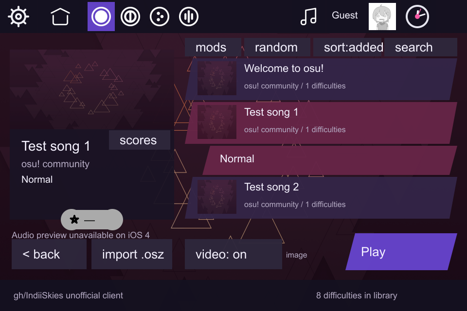

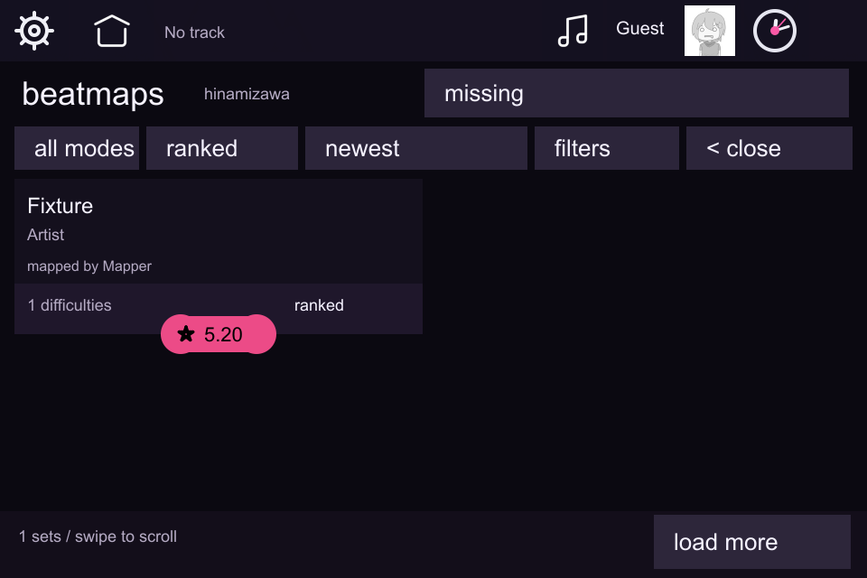

### Music, audio and video

- Dedicated **Now Playing** window with artwork, title/artist, playback controls, drag-to-seek, search and a scrolling song list.
- All songs and a saved custom playlist; add, remove, reorder, shuffle and repeat controls.
- Shared menu/browser music handling, beatmap previews, hitsounds and interface effects; separate master, music and effects volume.
- Apple audio decoding first, with cached FFmpeg conversion when the system decoder cannot handle a track.
- Dedicated gameplay loading screen, preparation before the audio clock starts, first-frame presentation gating and early-note lead-in.
- Beatmap video backgrounds through the native video decoder/compositor, with synchronised offsets and image fallback. Unsupported videos can be prepared as iPod-compatible companions on the Mac; see [video setup](port/VIDEO.md).

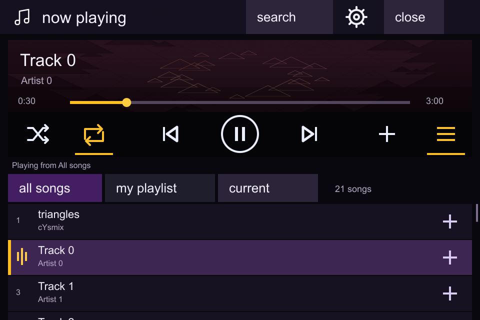

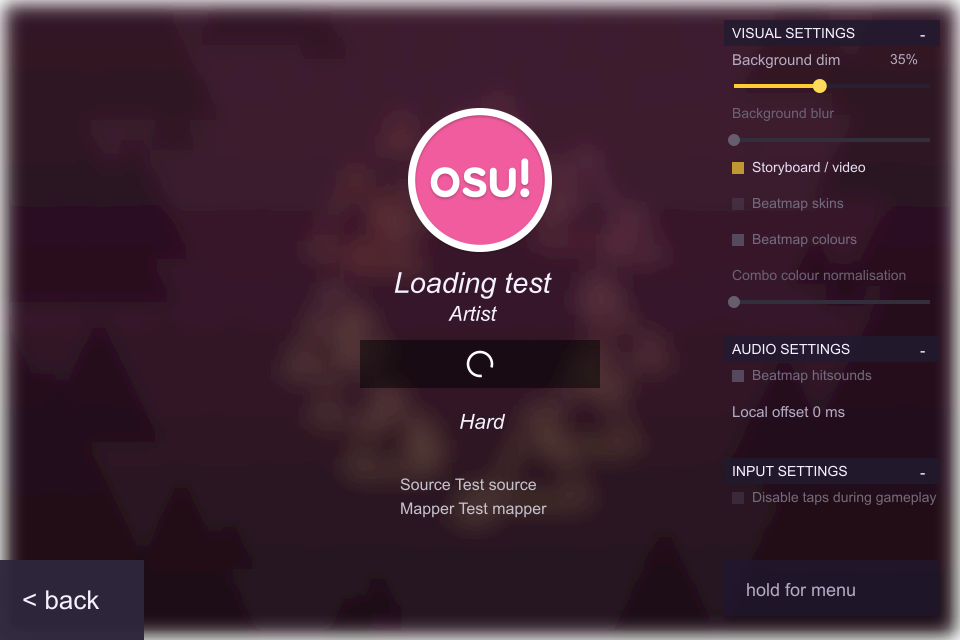

### Gameplay

- **osu!:** hit circles, approach circles, combo numbering/colours, sliders with repeats/ticks, and spinners.
- **taiko:** native maps and osu! conversions, centre/rim touch pads, drum feedback and animated Pippidon mascot.
- **catch:** native maps and conversions, fruits, droplets, tiny droplets, banana showers, walking, dashing and hyperdashes, catcher sprites and stacking effects.
- **mania:** native maps and conversions, touch lanes, chords, hold notes and separate judgement/scoring behaviour.
- Score, accuracy, combo, health, progress, timing feedback, optional cursor and local personal-best comparison.
- Pause menu with Continue/Retry/Quit, resume targeting/countdowns where applicable, failure screen and No Fail behaviour.
- Authored-break countdowns, local score persistence, and an animated results scene with grade, judgement counts, statistics, retry and return controls.
- Mod browser with ruleset filtering, conflicts and configuration for speed, accuracy target, difficulty overrides and random seed. Includes difficulty, automation, visibility, movement and other effects from the port's catalogue; see [mod implementation notes](port/ThirdParty/mods-provenance.md).

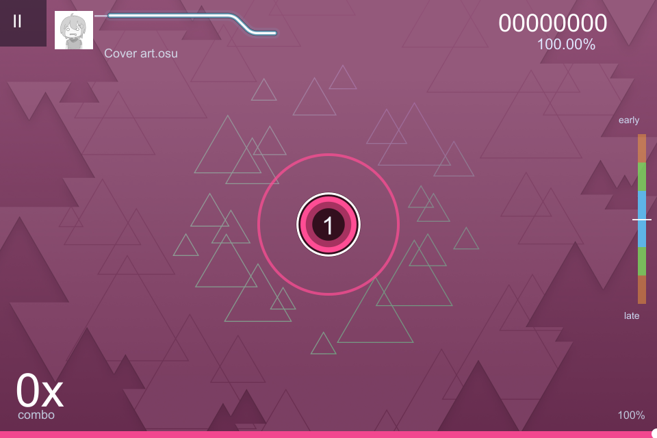

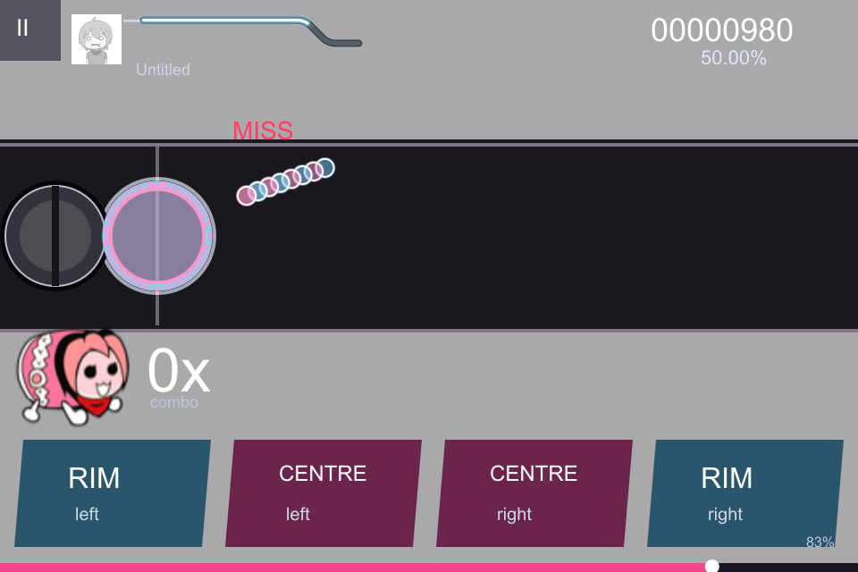

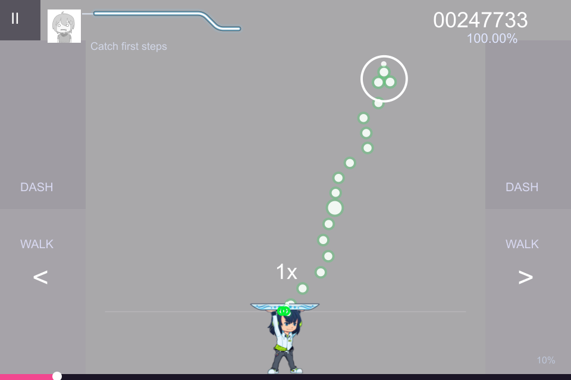

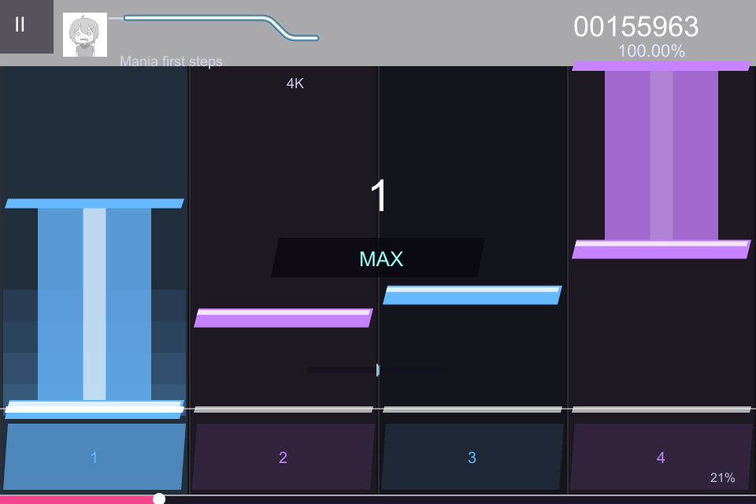

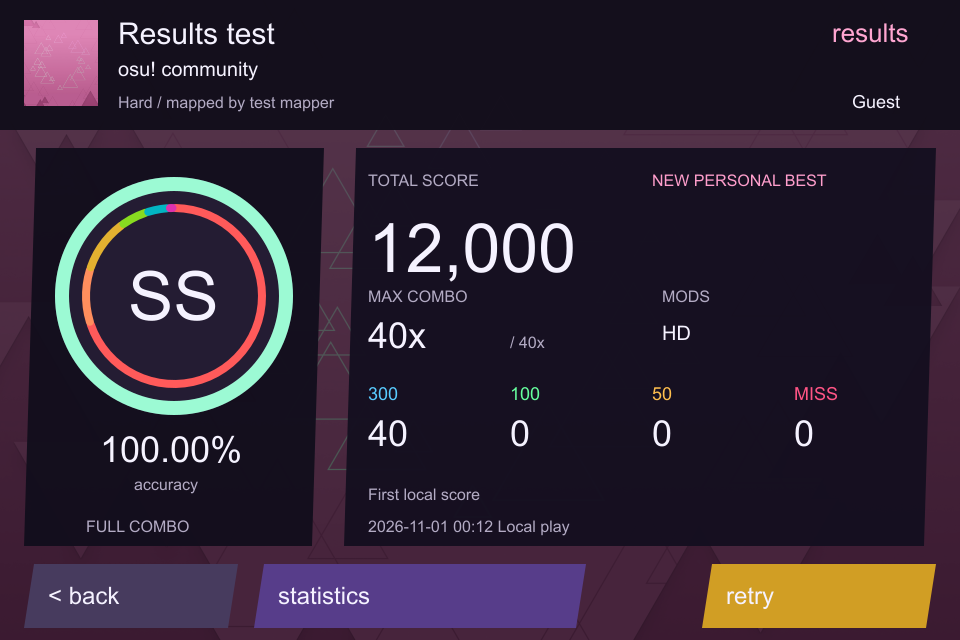

### Editors

- **Beatmap editor:** touch placement/selection/dragging, circles, straight sliders, spinners and native mania holds; timeline seeking, beat snapping, grid, zoom, duplicate/delete, undo/redo, metadata and difficulty settings, BPM/offset/SV/kiai editing, audio preview and play testing.
- Saves an edited copy alongside the original; subsequent saves use staged writes, validation and a backup, and refuse to overwrite an externally changed destination.
- **HUD layout editor:** movable/resizable gameplay components, rotation, opacity, visibility, duplication, alignment, snapping and undo/redo, with a separate saved layout for each ruleset.

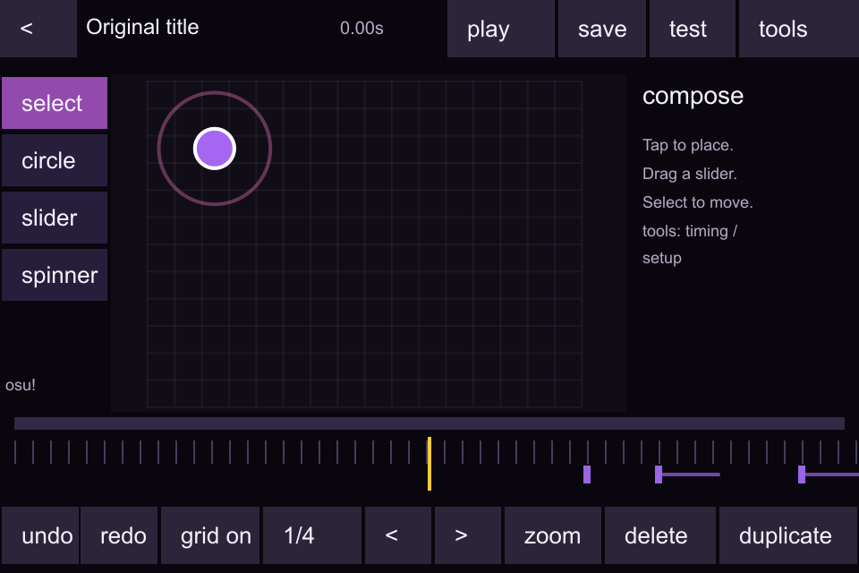

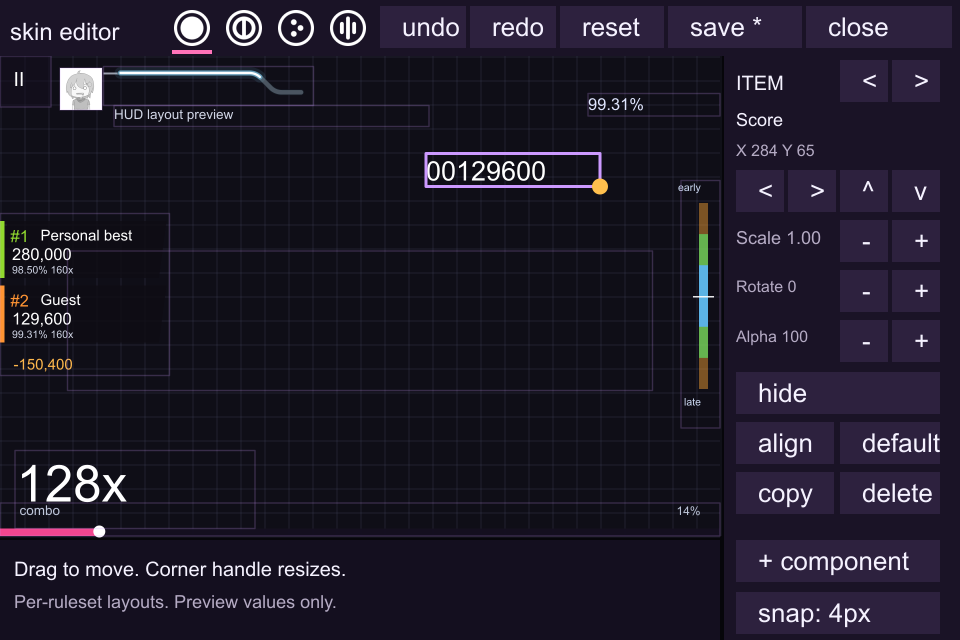

### Performance and settings

- Batched OpenGL ES 1.1 rendering, cached menu layers, glyph/image caches, smoothed geometry and one shared frame scheduler.
- Native FFT analysis runs separately from playback; importing and difficulty calculation use background workers and gameplay pause checkpoints.
- Reduced-effects option, independent gameplay cursor toggle and lower-resolution artwork settings.
- Optional **Settings → General → Debug → Performance overlay** for FPS, app CPU utilisation and GPU utilisation when the driver exposes a recognised counter.
- On-device errors and host/device profiling logs support debugging. Performance depends on the beatmap, media and enabled effects; **60 FPS is not guaranteed on this hardware**.

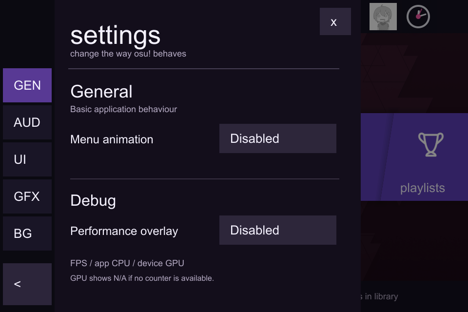

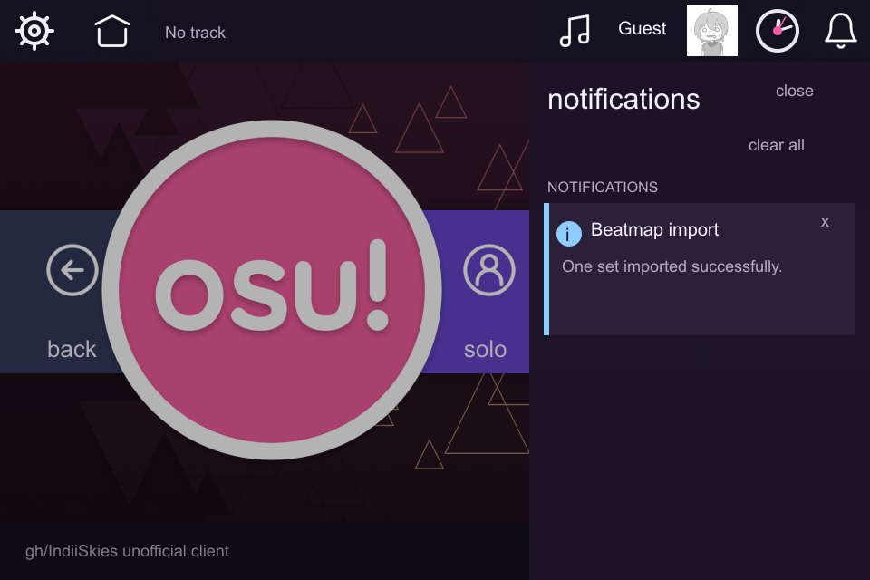

## Screenshots

The images above are saved **host-rendered UI previews generated during development**, exported from this project's preview files. They illustrate the port's screens and often use fixture songs/scores. They are not photographs or frame captures from the iPod, and do not capture every native GPU animation, scrolling layer or video background.

All 14 images are stored in [docs/screenshots](docs/screenshots). They are bundled with this documentation rather than linked to temporary chat attachments.

## Install and use

The existing workspace produces:

- `build/port/OsuLegacy-armv6-ios421-experimental.ipa`
- `build/port/OsuLegacy.app`

With a compatible jailbroken device connected and `ideviceinstaller` installed:

```sh
ideviceinstaller -u DEVICE_UDID install build/port/OsuLegacy-armv6-ios421-experimental.ipa
```

The app is named **Osu!**. Its bundle identifier is `org.osu.legacy.experimental`.

1. Open Osu! and let the intro finish.
2. Copy beatmap archives into the app's `Documents/Imports` directory using a device file-transfer tool, then choose **import .osz** in Solo. Alternatively, use **Browse** to download a set over Wi-Fi.
3. Choose **Play → Solo**, select a song/difficulty and ruleset, configure mods if desired, then press **Play**.
4. Open the music icon for the dedicated Now Playing window, or the cog for settings.

Use a correct device date for HTTPS certificate validation. The online browser uses device-side TLS 1.2 through BearSSL and a bundled CA trust store; no Mac network relay or API login is needed.

## Build from source

This workspace includes the source, downloaded tools and built dependencies used for the ARMv6 build. It is **not yet a one-command clean-clone bootstrap**: several large SDK/toolchain dependencies are ignored by Git and must be provisioned separately.

With the current workspace dependencies present:

```sh
# Rebuild the runtime if needed.
bash toolchain/build-mono.sh

# Compile calculators/converters, run host checks, build/sign/package the app.
bash port/build.sh
```

The build uses Mono **3.0.12**, a local iPhoneOS **4.2 SDK**, a replacement cctools linker, and the locally provisioned .NET 10 compiler for mechanically adapted upstream calculator/converter source. It does not replace the system Xcode installation. FFmpeg and BearSSL are built for ARMv6; their build scripts and source archives are under `toolchain/`.

Host checks cover gameplay and conversions, UI navigation, rendering geometry/layering, audio/video timing, imports, editors, mods, difficulty compatibility and persistent caches. Host success does not establish iPod frame rate or guarantee every imported map/media file works. Build output remains named `experimental`.

## Source layout

- [`port/Managed`](port/Managed): beatmap parsing, rulesets, menus, gameplay/HUD, editors, library/network services, local scores and difficulty adapter/cache.
- [`port/Native`](port/Native): iOS host, GPU rendering, audio/video, input, FFT, device metrics and TLS transport.
- [`port/Assets`](port/Assets), [`port/Sounds`](port/Sounds), [`port/Startup`](port/Startup): bundled interface, gameplay and startup resources.
- [`port/Tests`](port/Tests): host tests, fixtures and compatibility checks.
- [`port/ThirdParty`](port/ThirdParty): licences, provenance and source-adaptation notes.
- [`full-client/osu`](full-client/osu): supplied lazer reference source.
- [`mono-legacy`](mono-legacy), [`toolchain`](toolchain), [`probes`](probes): legacy runtime, build tools and device experiments.
- [`build`](build), [`logs`](logs): generated artifacts, previews and diagnostics.

## Scope and remaining limitations

- Online account login, multiplayer, global rankings, PP calculation, replay export and full storyboard support are not implemented. Some menu entries are present as part of the adapted navigation rather than complete services.
- Results and local scores use this port's judgement model; they are not eligible for official online submission.
- Local difficulty reuses the supplied lazer evaluators, but parser, curve approximation and converter differences can still affect end-to-end ratings. Online cards retain mirror-provided ratings. See [difficulty implementation notes](port/ThirdParty/difficulty-provenance.md).
- Mods use legacy rendering/input adaptations and do not expose every upstream setting or reproduce every shader exactly.
- The beatmap editor does not provide full desktop waveform/storyboard/path-control-point editing, multi-selection or asset management. The HUD editor does not implement the entire lazer skin editor or `.osk` asset import/export.
- Unsupported video transcoding currently runs on the Mac, not on the iPod. Heavy video/effects/maps may still reduce frame rate.
- v0.121 was installed successfully and passed host checks. Its new difficulty calculations still need a physical-device responsiveness/accuracy retest.

## Credits and licences

Based on work by **ppy Pty Ltd and osu! contributors**. The supplied osu! code is MIT licensed; see [osu! licence](port/ThirdParty/osu-LICENCE). Extracted upstream artwork, fonts and sounds have their own resource terms; see [resource licence](port/ThirdParty/osu-resources-LICENCE.md) and the individual provenance notes. Wallpaper packs retain their original owners' rights.

Additional dependencies include **Mono**, **FFmpeg**, **BearSSL** and **MiniZip**. Their applicable notices accompany the app/build sources. This is an independent community port, not an official ppy release. Review the bundled licences and resource permissions before redistributing a build.

Earlier implementation records and toolchain provenance are preserved in [historical development notes](docs/development-history.md). Those notes describe past versions and are not the current feature guide.
